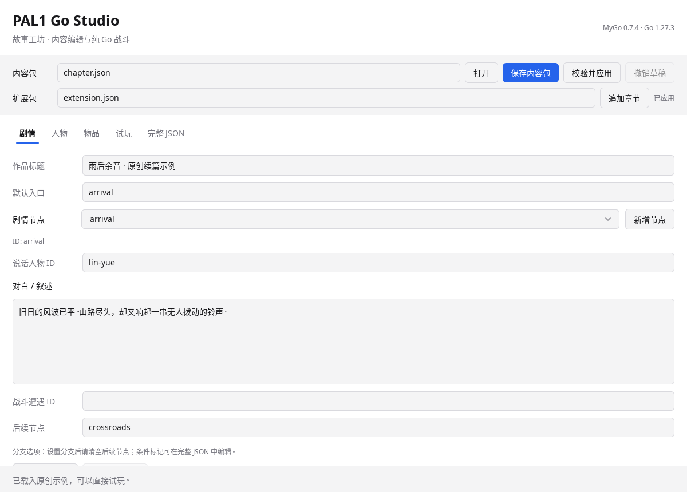
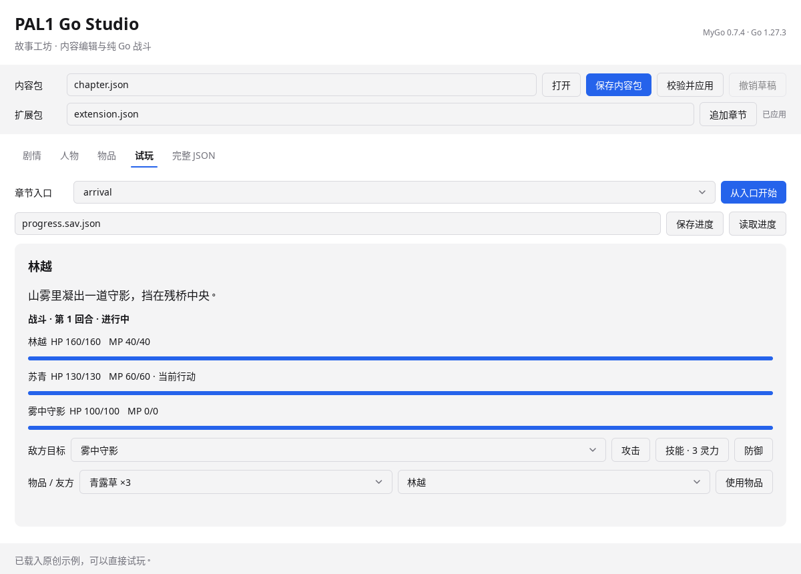

# PAL1 Go Studio · 故事工坊

`pal--reverse--learn` · learn rea

基于 PAL1 公开重实现资料开展学习，使用 **Go 1.27.3 + MyGo v0.7.4 原生 UI** 的剧情、人物、物品编辑器和可试玩的纯 Go 战斗原型。

**当前包含可运行的原创内容原型与部分原版数据执行器，尚未完成 PAL1 全流程。** 原创章节支持扩展包、剧情分支、人物/物品编辑、纯 Go 战斗和进度存取；原版适配已能导入场景、事件、角色、物品对象、敌人及对话表，执行部分脚本并保留逻辑会话状态。现已接入地图碰撞、方向移动/调查、MAP/GOP/MGO/PAT 静态视口和基于导入数值的 Go 回合战斗；完整脚本、战斗行动和全主支线仍在开发。研究内容与后续路线分别见 [研究证据](docs/RESEARCH.md) 和 [实现方案](docs/PLAN.md)。

当前没有可调用的 REA MCP/分析引擎。分析采用公开 SDLPAL 源码对照和本地纯 Go/Python 静态工具；另临时运行公开 C 解压、移动/调查和追逐参考进行对照，未安装或运行 APK。示例内容独立创作；新增导入工具只在本地读取原版素材，仓库不加入提取的台词、美术或音频。

## 运行

安装 Go **1.27.3 或更高版本**，在仓库根目录运行：

```sh
go run ./cmd/palstudio
```

使用 MyGo 的原生 Go UI，无须 Node、Bun 或浏览器前端。桌面运行需要操作系统图形会话及 MyGo 的平台运行库；Linux 使用 GTK 3、Wayland/X11 和图形驱动，具体依赖以 [MyGo v0.7.4 文档](https://github.com/egoist/mygo/tree/v0.7.4/docs) 为准。无显示器时可运行：

```sh
go run ./cmd/paltool demo
go test ./...
```

构建桌面程序和命令行工具：

```sh
make build
# 或
go build -o bin/palstudio ./cmd/palstudio
go build -o bin/paltool ./cmd/paltool
go build -o bin/palverify ./cmd/palverify
```

本工作区已将 Go 工具链放在 `/workspace/toolchains/go`；若系统 `go` 不是 Go 语言编译器，可用 `/workspace/toolchains/go/bin/go`，并设置可写的 `GOPATH=/workspace/toolchains/gopath` 和 `GOCACHE=/tmp/pal-go-cache`。这些路径只用于当前开发环境，不是用户机器的安装要求。

## 编辑与试玩

1. 启动后载入原创示例《雨后余音》。在“剧情”中新增节点、对白及分支，在“人物”“物品”中新增记录或修改数值。
2. “校验并应用”检查所有 ID、跨引用、数值和分支关系。成功后重置试玩；失败会保留已应用内容和运行进度。
3. “保存内容包”保存当前合法草稿为 JSON。未修改内容时保存不会重置试玩。“完整 JSON”可编辑战斗遭遇、敌人及 flags；先从表单同步，修改后点击“从 JSON 载入草稿”，再校验应用。
4. 在“试玩”选择入口开始，选择对白分支，进入战斗。战斗必须胜利才能继续；落败后可重试。战斗计算完全由 `internal/battle` 的 Go 代码执行。
5. “保存进度”与“读取进度”支持战斗中途恢复。存档保存内容包 SHA-256 和确定性行动序列；内容编辑后旧进度会被拒绝，避免错误套用状态。

试玩规则：人物列表前 **最多三位**组成队伍；每种物品初始三份，每次遭遇恢复全员 HP/MP；获胜后物品余量延续，失败重试还原本场开始时的物品。没有经验、装备、状态异常或奖励系统。以上是扩展原型规则，**并非原版 PAL1 数值行为**。技能固定消耗 3 MP，攻击力加倍；伤害为 `max(1, attack-defense/2)`，防御将伤害减半。敌人按速度顺序自动行动。

## 追加后续章节

```sh
go run ./cmd/paltool export-demo chapter.json
go run ./cmd/paltool merge chapter.json examples/chapter-two.json combined.json
go run ./cmd/paltool validate combined.json
```

也可在 UI 的扩展包路径中输入 `examples/chapter-two.json`，点击“追加章节”，保存合并内容包。扩展可以引用基础包人物和节点，不能覆盖同 ID 的基础记录，合并失败不修改工作区。独立扩展不一定能通过单独 `validate`，应通过与基础包合并进行校验。

合并保留基础包默认入口；第二章入口是 `river-arrival`。在试玩下拉选择该入口可独立预览。若要保持前章 flags 连贯进入后续故事，在剧情编辑器中将第一章末节点 `ending` 的“后续节点”设为 `river-arrival` 并应用；从基础默认入口重新运行即可连续推进。独立“从入口开始”会重置 flags 与初始物品。

内容文件 `schema_version=1`，使用稳定字符串 ID；条件选项的 `require_flags` 与节点 `set_flags` 可在完整 JSON 编辑。缺失 flag 视为 false，条件全部匹配才显示选项。允许作者设计循环；所有选择都被条件隐藏时需要修改内容，不能强制跳过。

## 命令行与资源研究

```sh
go run ./cmd/paltool play chapter.json
go run ./cmd/paltool mkf /path/to/your/data.mkf
```

`play` 支持交互式分支选择、战斗和进度存取，用 `help` 查看命令。MKF 工具只列目录和块长度，不解压、执行或改写文件；已对目录规模、偏移和读取大小设限。核心回归使用合成数据；实际样本的检查范围另列于 [输入数据记录](docs/INPUT_DATA.md)，不能由 MKF 目录检查推导完整游戏兼容。

## Windows 98 柔情篇全流程适配进度

目标仍为用户指定的 PAL1 / Windows 98 柔情篇。用户提供页面中的新 APK 已取得可导入数据，但实际为 **DOS 六 WORD 对象布局、Big5 与 YJ1**；页面的“98”名称不能确认原 Windows 发行身份。输入身份、计数和哈希见 [INPUT_DATA.md](docs/INPUT_DATA.md)。

`palverify` 支持导入、审计、单次诊断与 `journey` 连续空间路线。当前固定样本已从新游戏实际移动、调查、使用桂花酒，完成客栈、求药准备、登船航行并在仙灵岛落地：**1084 个连续动作、372 次消息引用，无显式事件 ID 跳转**。路线仅含资源摘要、数字输入和消息 ID，见 [路线](testdata/routes/sample-opening-island-landfall.json)。这段实际模型回放不代表全主线、全部支线或原程序运行对照通过；最新边界见 [缺陷队列](docs/BUGS.md)。

```sh
go run ./cmd/palverify journey -data "$PAL_DATA" \
  -compact -route testdata/routes/sample-opening-island-landfall.json -out reports/opening-journey.json
```

目录另需 `MGO.MKF`、`MAP.MKF`、`GOP.MKF`；彩色视口与相关淡入操作需要 `PAT.MKF`，动画/图片指令需要 `RNG.MKF`、`FBP.MKF`。资源留在用户本地。完整命令与证据范围见 [PALVERIFY.md](docs/PALVERIFY.md)。

新增[六石像连续路线](testdata/routes/sample-opening-six-statues.json)：1722 动作、374 次消息引用，实际经过四场 Go 数值战斗、六座石像、破天锤消耗及出口开启。原数值模式四战共 16 回合；`-battle-mode fast_verify` 在独立副本中把非零敌人初始 HP 降为 1，同路线共 8 回合，继续执行脚本与奖励。快验结果不能证明原版平衡一致。

MyGo 原版逻辑会话已支持[本地 JSON 保存和恢复](docs/SESSION_SAVE.md)，绑定资源摘要并保留策略与随机状态；尚不兼容原版 RPG 存档。快速战斗开关在显式重置会话后生效。

后续[返乡喂药清单](testdata/routes/sample-opening-medicine-campaign.json)已在同一会话连续验证2839动作、658次消息引用，覆盖宫殿剧情、离岛返乡和仙丹消耗，进入夜间。运行方式：

```sh
go run ./cmd/palverify campaign -data "$PAL_DATA" \
  -manifest testdata/routes/sample-opening-medicine-campaign.json \
  -out-dir reports/medicine-new-run -battle-mode fast_verify -max-steps 100000
```

父目录须已存在，输出目录中预定报告不能已存在。[分段验证说明](docs/PAL_CAMPAIGN.md)解释摘要链与失败记录；清单执行成功仍不代表全主支线已通关。

MyGo 的“原版数据”页可选择目录、编码和布局，记录单次调用或启用持续逻辑会话；“声明场景已进入”仅用于显式检查点测试。除了显式检查点回归，当前已从真实 `NewSession` 执行场景 1 开场脚本，再连续验证事件 5/6/7 的消息 ID、库存与重复触发拒绝；这属于逻辑顺序回放，没有证明地图上的调查距离、方向或原版程序行为一致。

使用方法见 [palverify 工具](docs/PALVERIFY.md)，验收标准见 [主支线验证](docs/WIN98_VALIDATION.md)，待处理问题见 [BUGS](docs/BUGS.md)。GitHub 上传授权步骤见 [连接授权说明](docs/GITHUB_AUTH.md)。

## APK 数据源初筛

```sh
go run ./cmd/palverify apk -file /path/to/game.apk
```

只检查归档元数据、文件摘要和 PAL98 必需资源的文件名候选。Git LFS 指针需要先取得原始对象；文件名匹配不表示资源格式或完整剧情已经验证。

## 界面预览

以下为 MyGo 原生无窗口渲染截图；尚未实测真实桌面窗口。





## 验证与开发

```sh
go test -race ./...
go vet ./...
```

测试涵盖严格内容解析、扩展合并与原子保存、非法战斗行动不改状态、确定性回合、剧情分支/胜利门控、战斗中途存档、错误存档不替换会话，以及 MyGo 无窗口真实控件交互。CI 配置了三平台构建；本地验证结果见 [review 记录](docs/REVIEW.md)。

分层：`content` 定义原创内容；`battle`、`story`、`studio` 管理原创试玩；`pal` / `paldata` 导入原版容器与表；`palcodec` / `palasset` 解压并检查资源元数据；`palflow` 执行部分指令；`palgame` 保存逻辑会话；三个 `cmd` 提供 MyGo UI、原创试玩 CLI 和原版验证 CLI。

许可：保留仓库原有 MIT 许可，详见 [LICENSE](LICENSE) 和 [第三方说明](THIRD_PARTY_NOTICES.md)。原版游戏素材应从合法持有的版本在本地导入；本仓库不提供素材下载。
